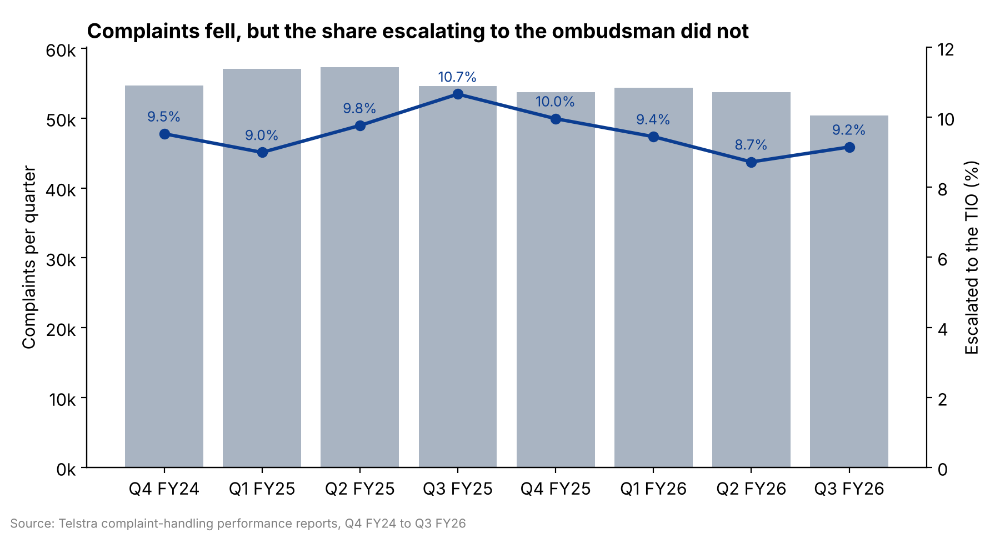
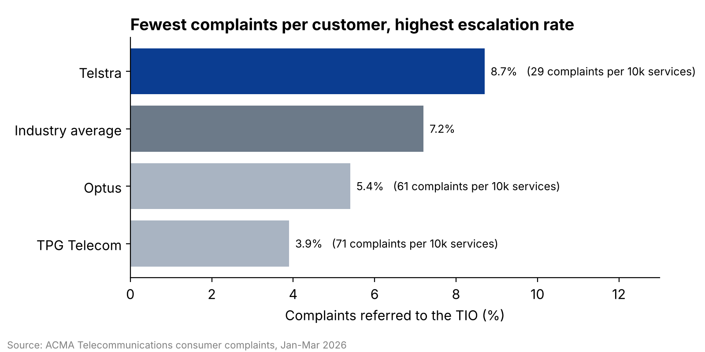
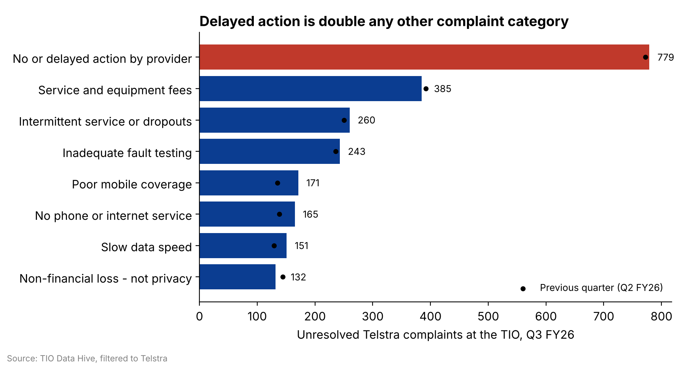
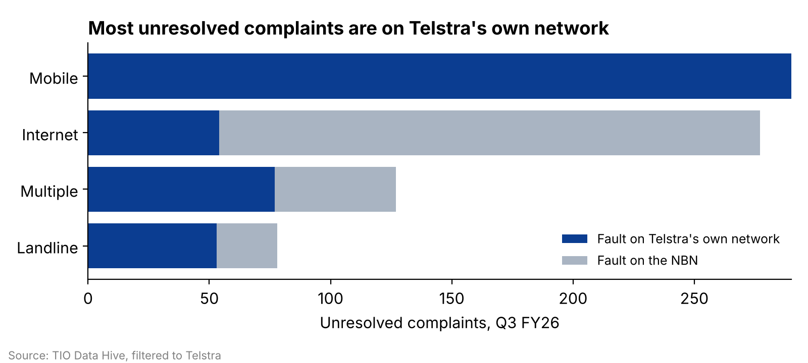

# Telstra complaint escalation analysis

**Why do Telstra's complaints keep reaching the ombudsman, even as complaint numbers fall?**

A decision-support analysis for a Telstra executive, built from public regulator and Telstra data. It identifies where escalations to the Telecommunications Industry Ombudsman (TIO) come from and what Telstra can control.

[Interactive dashboard](figures/dashboard.html) · Python · pandas · matplotlib · Plotly · Tableau (original dashboard)

---

## The decision

> Telstra should reduce the share of customer complaints that escalate to the TIO, because escalations carry regulatory and reputational cost, by fixing the complaint categories and process stages that hold the most unresolved cases.

## Key findings

| # | Finding | Evidence |
|---|---|---|
| 1 | **Fewer complaints, same escalation rate.** Quarterly complaints fell 7.8% over eight quarters, but the share escalated to the TIO stayed between 8.7% and 10.7% with no clear downward trend. | Telstra complaint-handling reports, Q4 FY24 to Q3 FY26 |
| 2 | **Fewest complaints per customer, highest escalation rate.** In Jan–Mar 2026 Telstra had 29 complaints per 10,000 services (Optus 61, TPG 71) but escalated 8.7% of them to the TIO, above the 7.2% industry average and well above Optus (5.4%) and TPG (3.9%). | ACMA consumer complaints report |
| 3 | **Delayed action is the biggest single problem.** "No or delayed action by provider" made up 779 unresolved Telstra complaints in Q3 FY26, twice the next category (service and equipment fees, 385). | TIO Data Hive |
| 4 | **Most of it is within Telstra's control.** 61.4% of unresolved complaints in Q3 FY26 were on Telstra's own network, not the NBN. Every mobile complaint was. | TIO Data Hive |

Run `python src/analysis.py` to reproduce every number above from the files in `data/`.






## What it means for the decision

- Falling complaint volume is **not** evidence the problem is fixing itself: the escalation rate has not moved with it.
- The lever is **speed of action**, not complaint prevention. Delayed action dominates unresolved cases.
- Because most cases sit on Telstra's own network, a dedicated case-management function could act on them without waiting on NBN Co.

## Performance indicators proposed

| Indicator | Baseline | Target | Type |
|---|---|---|---|
| TIO escalation rate | 8.7–10.7% per quarter | At or below the industry average (~7%) within 12–18 months | KPI |
| Average resolution time | 9 days (Jan–Mar 2026) | Industry average (5.3 days) | PI |
| Unresolved "delayed action" cases | 779 (Q3 FY26) | Downward each quarter | PI |
| Share of complaints on the NBN | 38.6% (Q3 FY26) | Not set: outside Telstra's control, used as context | Context |

## Data

All figures were compiled by hand from public reports in August–September 2026. They are in `data/` as CSV.

| File | Source |
|---|---|
| `telstra_quarterly.csv` | [Telstra complaint-handling performance](https://www.telstra.com.au/contact-us/feedback-complaints/complaint-handling-performance) |
| `acma_carrier_comparison.csv` | ACMA, Telecommunications consumer complaints, Oct–Dec 2025 and Jan–Mar 2026 |
| `tio_unresolved_by_category.csv` | [TIO Data Hive](https://www.tio.com.au/data-hive), filtered to Telstra |
| `tio_network_split_q3fy26.csv` | TIO Data Hive, filtered to Telstra, Q3 FY26 |

## Limitations

- **Two escalation measures.** Telstra's own quarterly figures (escalations ÷ complaints) give 9.2% for Q3 FY26; ACMA reports 8.7% for Jan–Mar 2026. They count differently, so each chart uses one source only.
- **Descriptive, not causal.** The data shows where unresolved cases build up, not why.
- **No reopen or repeat-contact data.** No carrier publishes it, so first-contact resolution can't be measured directly.
- **Complaint rates measure who complains, not who suffers.** Groups less likely to complain are under-represented.

## Repository structure

```
data/        source data (CSV)
figures/     charts and the interactive dashboard
src/         analysis.py: reproduces every number and chart
```

## About

Built by **Satish Kumar Reddy Gajjala** as part of the Master of Data Science at the University of Adelaide.
[LinkedIn](https://www.linkedin.com/in/satish-kumar-reddy-gajjala-450150234/) · [GitHub](https://github.com/satish9346)
